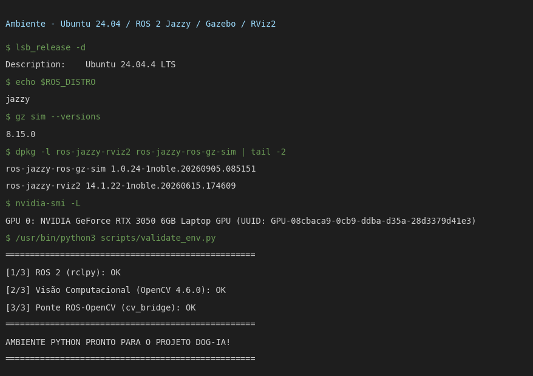
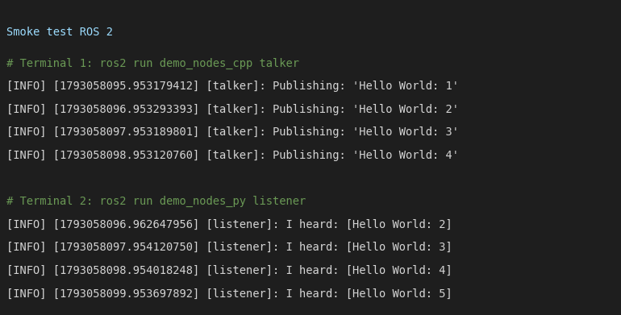
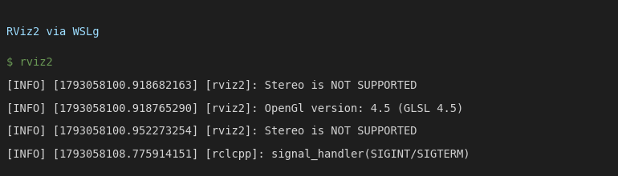
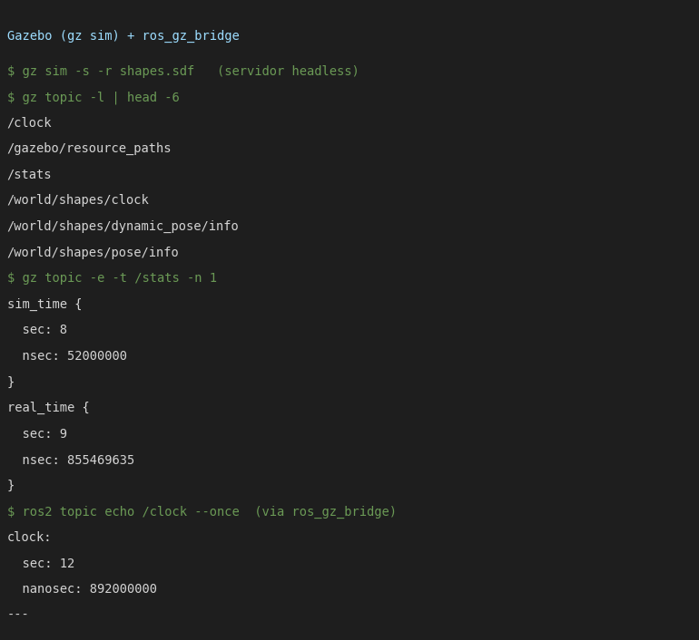

# Resultados Aula 06

Bruno Menezes Gomes / Henrique Ribeiro Siqueira
05/10/26

Setup do ambiente do DOG-IA (AC-3, Etapa 1). Prints abaixo são capturas do terminal com a saída real dos comandos.

## Ambiente

Ubuntu 24.04 (WSL2/WSLg) com **ROS 2 Jazzy** (o guia cita Humble/Ubuntu 22.04, o roteiro aceita Humble ou Jazzy), Gazebo (`gz sim` 8.15.0), RViz2 14.1.22, `ros_gz` 1.0.24 e GPU NVIDIA RTX 3050 visível no WSL.

`validate_env.py` (rclpy, OpenCV 4.6.0 e cv_bridge) passou nos 3 testes. Precisa rodar com `/usr/bin/python3`: o `python3` do pyenv (3.11) não enxerga o rclpy do Jazzy (3.12).

## Smoke test: talker / listener

Dois terminais: `ros2 run demo_nodes_cpp talker` e `ros2 run demo_nodes_py listener`. O listener recebe `Hello World: N` em tempo real (a primeira mensagem se perde porque o listener sobe 1 s depois, ele pega a partir do 2).

## RViz2

Abre pelo WSLg, OpenGL 4.5 (GLSL 4.5) reportado pelo próprio RViz2.

## Gazebo

Servidor `gz sim -s -r shapes.sdf` sobe, publica `/stats` com `sim_time` avançando, e o `ros_gz_bridge` traz o `/clock` do Gazebo para um tópico ROS 2.

## Checklist do roteiro (05/10)

| # | Passo | Status |
|---|---|---|
| 7-8 | Máquina oficial (WSL2) e ROS 2 / Gazebo / RViz2 instalados e validados | feito (evidências acima) |

# Relatório

**1. Resultados**

- ROS 2 Jazzy, Gazebo e RViz2 instalados; comunicação publisher/subscriber validada pelo talker/listener.
- Gazebo roda em modo servidor e conversa com o ROS 2 pelo `ros_gz_bridge`.

**2. Parte mais difícil**

Python do sistema vs. pyenv. Rodar `validate_env.py` com o `python3` padrão falha em `import rclpy`, porque o ROS 2 Jazzy instala os módulos para o Python 3.12 do sistema. Resolve usando `/usr/bin/python3` e `source /opt/ros/jazzy/setup.bash`.

**3. Impressões gerais**

O modelo de nós + tópicos já é o mesmo que a gente simulou nas Aulas 03-05 com funções soltas, agora com middleware de verdade. O smoke test é simples, mas valida o pior ponto de qualquer setup (rede/DDS entre processos).
