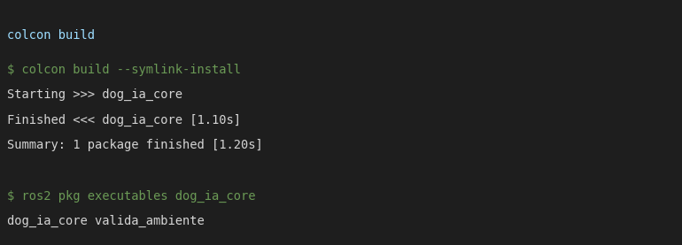
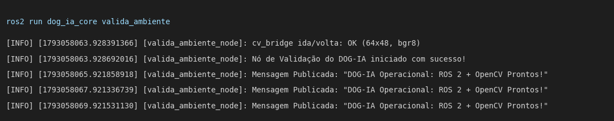
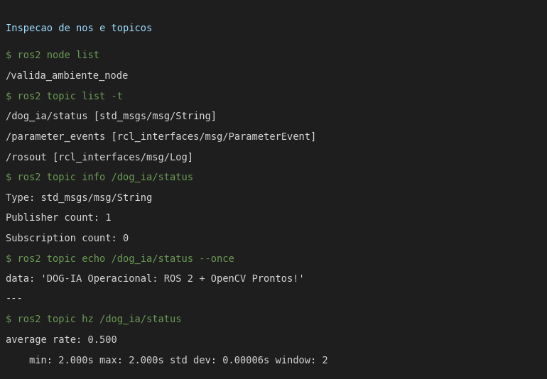
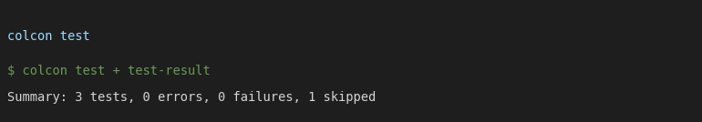

# Resultados Aula 07

Bruno Menezes Gomes / Henrique Ribeiro Siqueira
26/10/26

Revisão da parte 1 (setup) e aplicação da parte 2 (workspace + primeiro nó Python) do `Guia Projeto DOGUIA.md`. Código em `dog_ia_core/`. Prints são capturas do terminal com a saída real.

## Etapa 1 — Revisão do ambiente

Mesmo ambiente da Aula 06 (Ubuntu 24.04, ROS 2 Jazzy, Gazebo 8.15, RViz2). O guia usa Humble/Ubuntu 22.04; adaptações:

| Guia (Humble) | Aqui (Jazzy) |
|---|---|
| `ros-humble-desktop-full` | `ros-jazzy-desktop` + `ros-jazzy-ros-gz` |
| `gazebo` (Classic) | `gz sim` (Gazebo Harmonic) |
| `source /opt/ros/humble/setup.bash` | `source /opt/ros/jazzy/setup.bash` |

Smoke test talker/listener já validado na Aula 06.

## Etapa 2 — Pacote `dog_ia_core`

Pacote `ament_python` criado com
`ros2 pkg create --build-type ament_python dog_ia_core --dependencies rclpy sensor_msgs cv_bridge std_msgs`.
Nó `valida_ambiente` em `dog_ia_core/dog_ia_core/valida_ambiente.py`, registrado no `setup.py`:

```py
'console_scripts': [
    'valida_ambiente = dog_ia_core.valida_ambiente:main',
],
```

O nó publica `std_msgs/String` em `dog_ia/status` a cada 2 s. Além do guia, na inicialização ele faz uma ida e volta `numpy → sensor_msgs/Image → numpy` com o `cv_bridge`, para provar que a ponte ROS–OpenCV funciona.

### Build

```
cd ros2_ws && colcon build --symlink-install
source install/setup.bash
ros2 run dog_ia_core valida_ambiente
```



### Execução do nó



### Nós e tópicos

`/valida_ambiente_node` aparece em `ros2 node list`; `/dog_ia/status` tem 1 publisher e frequência 0.5 Hz (2 s), como configurado.



### Testes do pacote

`colcon test`: copyright (skipped no template), flake8 e pep257 passam.



## Checklist de avaliação

| Requisito | Status |
|---|---|
| ROS 2 e Gazebo instalados e operacionais (Jazzy no lugar de Humble) | [x] |
| Workspace compilado com o pacote `dog_ia_core` | [x] |
| Nó `valida_ambiente` transmitindo em `dog_ia/status` | [x] |

---

# Relatório

**1. Resultados**

Pacote compila, o nó sobe, publica a cada 2 s e o tópico é visível por outro processo (`topic echo`, `topic hz`). `cv_bridge` converte nos dois sentidos sem perda (64x48, bgr8).

**2. Parte mais difícil**

Passar nos testes de estilo do `colcon test`. O código do guia (comentários "Linha N" e docstrings multilinha) quebra flake8/pep257: docstring de uma linha terminada em ponto, imperativo (D401) e ordem de imports. Também: matar o nó com SIGTERM gera `ExternalShutdownException` no `rclpy.spin`; tratei no `main` junto do `KeyboardInterrupt` e usei `rclpy.try_shutdown()`.

**3. Impressões gerais**

O primeiro nó é pequeno, mas já fecha o fluxo que vai se repetir em todos os pacotes do DOG-IA: `pkg create` → código → `setup.py` → `colcon build` → `source` → `run` → inspeção. A pasta `build/`, `install/` e `log/` fica fora do repositório (workspace separado).
