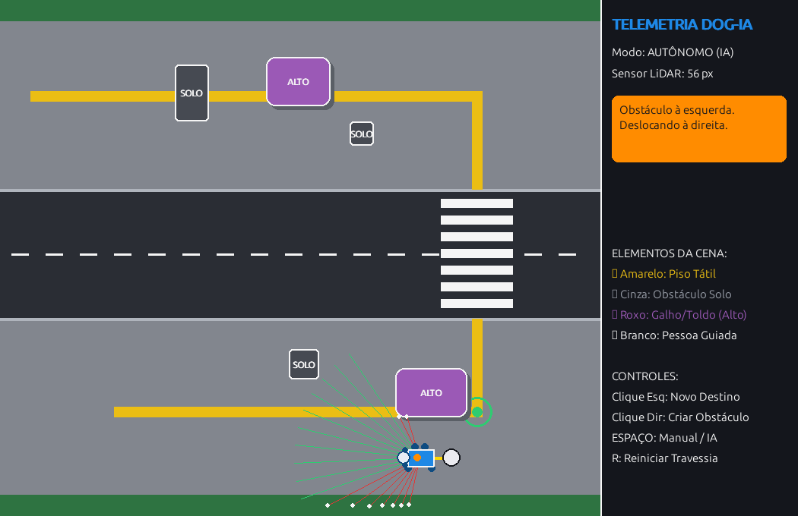
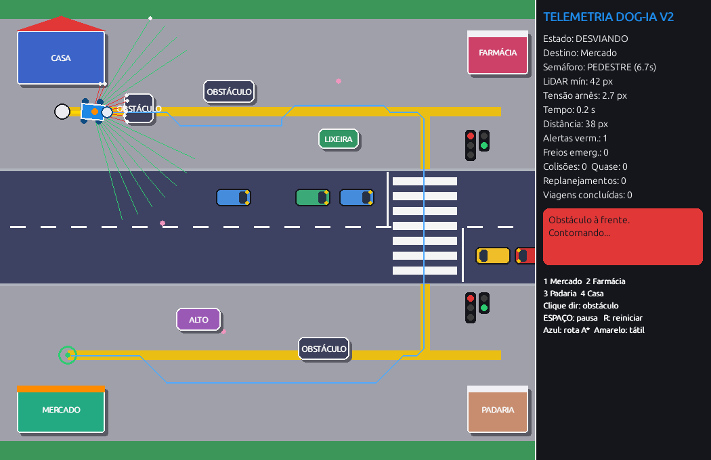
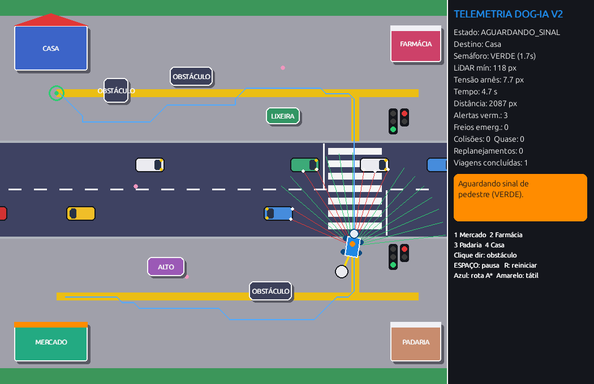
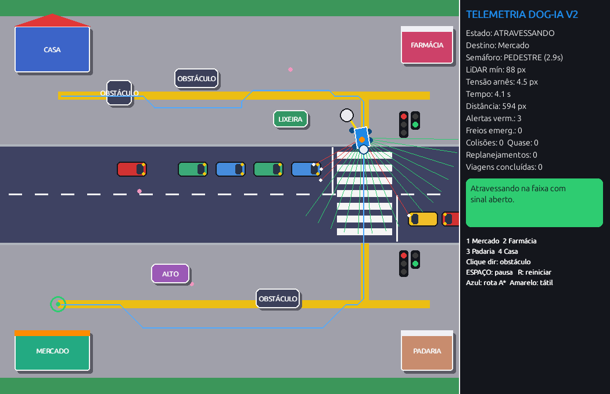

# AULA 08 — AC-4 Entrega Final — DOG-IA V2

Código: `dog_ia_v2.py` (evolução de `dog_ia_sim_V1.py`).

```
python dog_ia_v2.py                         # simulador interativo (1-4 destino, clique direito cria obstáculo)
python dog_ia_v2.py --benchmark 20 --seed 1 # benchmark headless
python dog_ia_v2.py --demo --salvar prints  # viagem ida e volta + prints
```

## Prints

| V1 | V2 |
|---|---|
|  |  |

V2 — semáforo, travessia e chegada:





## O que foi implementado

| Marco | Implementação |
|---|---|
| 1 | Semáforo `VERDE → AMARELO → TODOS_VERM_1 → PEDESTRE → TODOS_VERM_2` com `dt` fixo. Carros em duas mãos com `ACEL`, `DESACEL`, distância de seguimento e parada antes da linha. 12% de veículos infratores. `aplicar_barreira` bloqueia o meio-fio fora da faixa ou sem autorização. |
| 2 | Grade 10×10 px, A\* octile, C-Space (solo 30, prédio 22, suspenso 38 px), piso tátil com custo 0,45, destinos 1–4, replanejamento após 3,5 s sem progresso. |
| 3 | LiDAR com `rect.clipline`, ruído gaussiano σ=1,5 px, dropout 2%, mediana em `deque(maxlen=3)`. Zona varrida (Δt = 1 s) dos veículos aciona `FREIO_EMERGENCIA`. |
| 4 | `Tutor` independente preso por arnês de 42 px. Tensão > 10 px reduz a velocidade do robô. Beep estéreo (`pan` −1..+1). Métricas e `--benchmark`. |

---

## Questão 1 — Arquitetura híbrida

**Qual limitação da navegação reativa é resolvida e por que o planejador global sozinho não basta?**

Um controlador apenas reativo toma decisões com base no que o LiDAR detecta naquele momento e dentro de seu alcance de 165 px. Sem uma visão ampla do mapa, pode não encontrar saída em configurações como becos ou obstáculos em U, além de não planejar previamente o acesso à faixa nem priorizar o piso tátil. O A* acrescenta essa orientação global: calcula um caminho até o destino e considera o menor custo das rotas acessíveis.

O A* depende de um mapa conhecido e não acompanha com rapidez cada mudança ao redor do robô. Veículos, pedestres e obstáculos que surgem durante o percurso exigem respostas locais, como desviar ou frear. Por isso, na V2, o planejador define o trajeto geral, enquanto a navegação reativa responde às situações inesperadas; se o progresso parar, o caminho pode ser recalculado.

## Questão 2 — Máquina de estados

Viagem completa Casa → Mercado (seed 1, semáforo iniciando em VERDE, sem obstáculo extra):

**1) Estados em ordem e causa de cada transição**

| # | Estado | Transição / condição |
|---|---|---|
| 1 | `PLANEJANDO` | Destino escolhido; o A\* calcula a rota. |
| 2 | `NAVEGANDO` | Rota pronta; segue os pontos pelo piso tátil. |
| 3 | `AGUARDANDO_SINAL` | Chegou ao meio-fio antes da faixa e o sinal de pedestre não está aberto (ou não há tempo/via livre). |
| 4 | `ATRAVESSANDO` | Fase `PEDESTRE` com `tempo_restante > 2,44 s` e via livre; barreira liberada. |
| 5 | `NAVEGANDO` | Robô e tutor saíram da rua; barreira volta a bloquear. |
| 6 | `CHEGOU` | Distância ao destino < 20 px. |

Log real: `PLANEJANDO → NAVEGANDO (0 s) → AGUARDANDO_SINAL (4,0 s) → ATRAVESSANDO (9,5 s) → NAVEGANDO (11,1 s) → CHEGOU (14,9 s)`.

Estados que aparecem só quando necessário: `DESVIANDO` (obstáculo à frente ou lateral, desvio reativo) e `FREIO_EMERGENCIA` (veículo em rota de colisão).

**2) AGUARDANDO_SINAL × FREIO_EMERGENCIA**

- `AGUARDANDO_SINAL` é uma espera planejada e previsível no meio-fio. A causa é uma regra de trânsito (sinal fechado, tempo insuficiente ou via não livre). Não há risco imediato; o robô para antes de entrar na rua.
- `FREIO_EMERGENCIA` é uma reação de segurança a um perigo iminente. Dispara em qualquer lugar (inclusive no meio da faixa) quando a zona varrida de um veículo em movimento, projetada 1 s à frente, intercepta o robô ou o tutor. Tem prioridade sobre todos os outros estados e mantém o robô parado por 0,5 s após o perigo passar.

## Questão 3 — Percepção e ruído

**1) Por que mediana e não média para leituras "= alcance máximo"?**

Quando ocorre um *dropout*, o sensor pode registrar o alcance máximo de 165 px mesmo havendo um obstáculo próximo. Em uma sequência como 60, 61 e 165 px, a média sobe para aproximadamente 95 px e representa mal a distância real. A mediana permanece em 61 px, pois um único valor extremo não altera o valor central do conjunto.

**2) Atraso do filtro**

Com janela de 3, o obstáculo real só vira mediana quando 2 das 3 leituras já o mostram. Isso significa 1 varredura extra de espera: 1/60 s ≈ **0,017 s (17 ms)**. É desprezível: a 156 px/s o robô anda cerca de 2,6 px nesse tempo.

**3) E com 15 varreduras?**

A mediana só muda após 8 leituras novas, ou seja 7 varreduras extras: 7/60 ≈ **0,117 s** de atraso (~18 px a 156 px/s). O filtro rejeitaria ruído melhor, mas o robô reagiria tarde a obstáculos e carros novos, e as leituras ficariam "arrastadas" em curvas.

## Questão 4 — Segurança temporal

**1) Limite em segundos**

```
(RUA_ALTURA + 24 + GUIA) / velocidade × 1,35 + 0,4
= (170 + 24 + 42) / 156 × 1,35 + 0,4
= 236 / 156 × 1,35 + 0,4
= 1,513 × 1,35 + 0,4
≈ 2,44 s
```

A travessia só começa se restarem mais de 2,44 s na fase `PEDESTRE`. Isso inclui o robô e o tutor (42 px do arnês) saírem da rua, mais 35% de margem e 0,4 s fixos.

**2) Por que "todos vermelhos" de 1,5 s?**

Esse intervalo funciona como uma margem para esvaziar o cruzamento antes da próxima fase. Ele dá tempo para um veículo que entrou no fim do amarelo, ou que desrespeitou o sinal, deixar a faixa antes de liberar a travessia dos pedestres. Ao final da fase `PEDESTRE`, o estado `TODOS_VERM_2` também permite que quem ainda está cruzando alcance o outro lado antes de os carros voltarem a avançar.

## Questão 5 — Avaliação experimental

20 viagens Casa → Mercado, cada uma com fase inicial do semáforo e tráfego sorteados (arquivos em `resultados/`).

**1) Resultados**

| Métrica | `--seed 1` | `--seed 7` |
|---|---|---|
| Taxa de sucesso | 20/20 (100%) | 20/20 (100%) |
| Tempo médio | 15,4 s | 18,6 s |
| Colisões | 0 | 0 |
| Quase-colisões | 0 | 0 |
| Freios de emergência | 1 | 0 |

**2) Seed fixa × resultados diferentes**

A seed inicializa o gerador pseudoaleatório. Com a mesma seed, a sequência de números é idêntica, então fase inicial do semáforo, geração de carros, infratores, ruído e dropout do LiDAR se repetem e o mesmo comando devolve o mesmo resultado. Com seeds diferentes (1 e 7) a sequência muda: o robô chega ao meio-fio em momentos diferentes do ciclo do semáforo (espera maior ou menor), os carros aparecem em outros instantes e o ruído do sensor é outro. Por isso os tempos médios diferem (15,4 s × 18,6 s), mesmo com o mesmo código.

**3) Melhoria proposta**

Aumentar o horizonte de verificação de via livre (de 2,5 s para 3,5 s) e a margem de segurança (inflação de 30 → 40 px). Esperado: melhora em colisões, quase-colisões e freios de emergência (o robô só entra com folga maior). Piora esperada: tempo médio (o robô espera mais ciclos de semáforo) e taxa de sucesso dentro do limite de tempo, já que alguns trajetos ficam bloqueados.

---

## Etapa bônus

Pendente (manual): vídeo de 20–40 s com ida e volta (`python dog_ia_v2.py`, tecla `1` e depois `4`), post no LinkedIn marcando o grupo e o professor, e-mail com link do vídeo e do GitHub.

