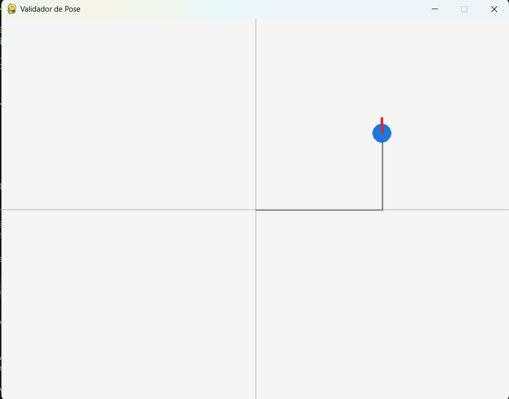
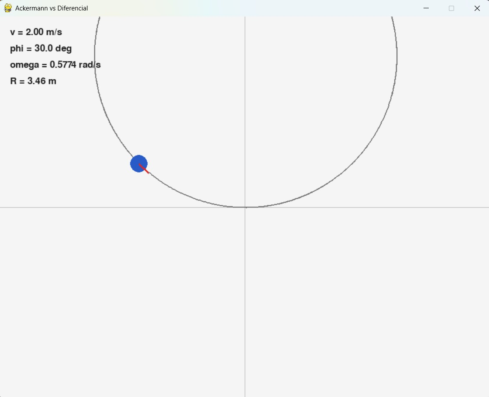
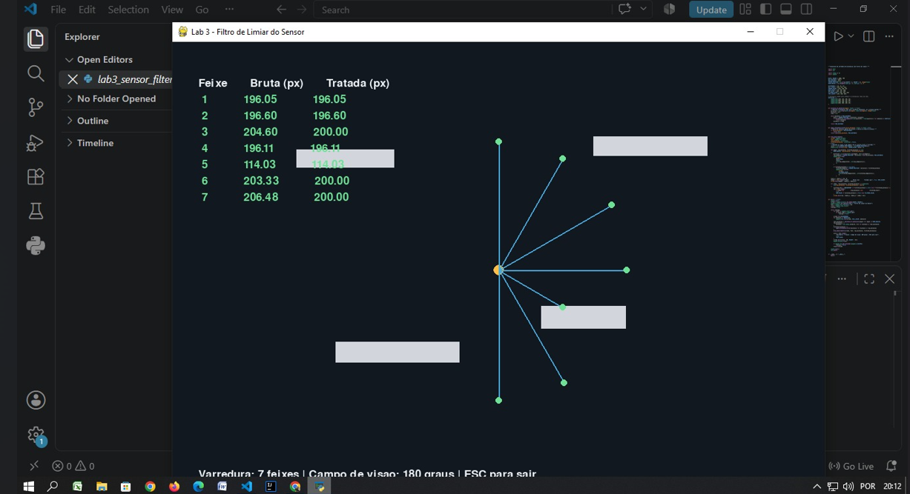
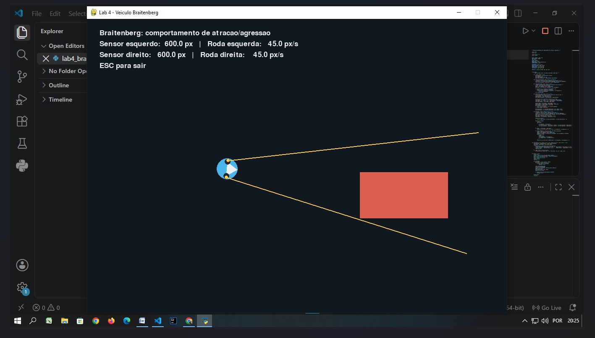
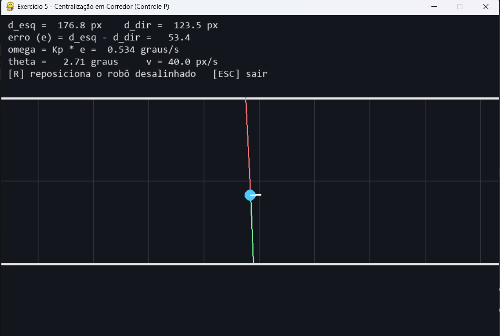

Lab 01:

O código simula o movimento de um robô em 2D usando a modelagem cinemática diferencial. A pose do robô é representada por x, y e θ, e a cada passo o programa atualiza esses valores com base em v e ω por meio de:

avanço linear na direção atual
rotação da orientação
integração ao longo do tempo
Os trechos definidos no início do programa representam uma sequência de ações: deslocamento reto, giro e novo deslocamento. O script calcula a pose teórica e a pose simulada e compara os resultados. Também desenha o robô em uma janela com Pygame e mantém um rastro do trajeto percorrido, para visualizar o caminho.

A correção principal foi ajustar a velocidade angular do segundo trecho para que o giro fosse exatamente de 45°, conforme o enunciado. O resultado final é validado pela saída no terminal, que mostra que a pose teórica e a simulada coincidem.

Explicação exercício 2:

Esse exercício simula o comportamento de um veículo com direção Ackermann, em que a frente do carro gira de forma diferente da traseira. A ideia é mostrar como a velocidade angular do veículo depende do ângulo de esterço das rodas dianteiras e da velocidade linear do carro.

O programa usa Pygame para desenhar o veículo em movimento e acompanha sua trajetória no plano. O usuário controla a velocidade e o ângulo de esterço com o teclado, e o carro percorre uma curva proporcional a esses valores. O código também calcula e exibe no visor o raio de curvatura e a velocidade angular resultante.

A parte importante do exercício é demonstrar que, em um sistema Ackermann, o ângulo de esterço é limitado a ±30°, então o veículo não consegue girar no lugar como um robô diferencial. Em vez disso, ele realiza uma curva com raio finito, o que representa o comportamento real de um carro.

Lab 03:

 O código simula um sensor com 7 feixes em 180°, calcula a distância até obstáculos usando ray casting, adiciona ruído gaussiano às medições.

Aplica um filtro:
abaixo de 10 px: descarta;
acima de 200 px: limita para 200.
Mostra no Pygame o valor bruto e o valor filtrado lado a lado.

As principais técnicas usadas são simulação de sensor, ray casting, ruído gaussiano, filtro de limiar, vetorização básica com NumPy e loop de eventos do Pygame.

Lab04:
 A técnica usada é o comportamento de Braitenberg, com:
Controle reativo: o robô reage diretamente aos sensores.
Conexão sensor-roda: cada sensor controla a roda do mesmo lado.
Movimento diferencial: velocidades diferentes nas rodas fazem o robô virar.
Atração/agressão: quanto mais perto o obstáculo, mais rápida fica a roda correspondente.

Exercicio 5 :

O exercício implementa um controle proporcional em malha fechada para manter o robô centralizado em um corredor.
Sensores: dois feixes laterais medem as distâncias até as paredes (d_esq e d_dir).
Erro: é calculado pela diferença entre as distâncias:
e = d_esq - d_dir.
Controle: o erro determina a correção da direção:
ω = Kp × e, com Kp = 0,01.
Movimento: o robô mantém velocidade linear constante de 40 px/s.
Correção automática: quando o robô se aproxima de uma parede, a diferença entre as distâncias gera uma correção para que ele retorne ao centro.
Resultado: o robô começa desalinhado e ajusta sua trajetória continuamente, buscando manter d_esq ≈ d_dir.

